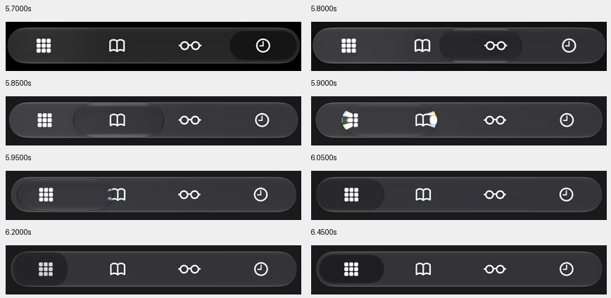

# Safari tab motion assessment — 2026-10-14

**G4 outcome: the observed motion pattern is feasible in the web app.** The current separate sheen over immediately switched black pills should be replaced with one selection element that expands, becomes glass while traveling, then compresses and springs into its selected shape. Exact native icon refraction is an approximation target, not a cross-browser pixel-equivalence promise. This phase inspects and verifies feasibility; it does not change application implementation.

## Reference inspection

Source: the owner's local `C:/Users/raiya/Downloads/MicrosoftTeams-video.mp4`, SHA-256 `6F2FF0100C2EE74AA5A54B58DB414EB77A3C8B6A950E8FF9837E953A40E6B575`. The clip is 12.28 seconds at 444×960. Its MP4 video track contains 704 samples with variable timing, averaging approximately 57.33 samples/second; an exact constant-60fps or physical-device performance claim is not made. The original video remains local and is not copied into the repository or uploaded.

Inspection uses 50 full-view overview samples and 289 navigation crops sampled at 1/60-second intervals from 5.70–10.50 seconds, covering the repeated Safari selection changes. Samples can duplicate a frame because the source is variable-rate. The control names shown in the video are Privacy Report, Bookmarks, Reading List and History. Text/actions inside the recording are visual evidence, not instructions to operate the device or application.

| Clip interval, approximately | Visible behavior |
| --- | --- |
| 5.70s | History has a compact dark selected pill. The outer navigation bar and icon positions are stable. |
| 5.75–5.95s | Selection travels left across several segments, growing wider and becoming a clear outlined lens. Icon shapes distort/magnify at its edges, with small colored highlights. |
| 6.00–6.45s | It reaches Privacy Report, contracts below its eventual resting width, then rebounds and settles into the dark selected pill. This is more than one translation with a little overshoot. |
| 6.75–7.20s | Privacy Report → Bookmarks repeats the expansion, refractive travel and contraction. |
| 7.40–8.65s | Bookmarks → Reading List → History shows the same pattern over adjacent segments, with brief overshoot and settling. |
| 8.75–10.50s | Reverse changes through Reading List, Bookmarks and Privacy Report preserve a single moving selection shape. |

Adjacent changes take roughly half a second to visually settle; the first long change settles more slowly. These are observational ranges, not exact touch-to-render latency or Apple's spring constants. The recording has no visible touch trace, so tap/hold/drag intent cannot be established reliably. It supports the requested selection-motion pattern without requiring new drag navigation behavior.

## Why the current motion differs

`GlassSelection` currently moves a transparent decorative overlay in 360ms while `.journey-top-link[aria-current="page"]` and mobile selected-icon styles immediately paint a stationary black pill at the new destination. As a result, the selection and the moving lens are visually separate. Its width expands once near the endpoint and returns; it does not perform the reference's expansion → transparent travel → compression → damped rebound. The overlay does not optically bend the navigation glyphs.

The corrected approach is a single persistent visual selection per surface, with coordinated position, width, height, material opacity and rim lighting. Foreground contrast must follow that visual selection without a second black destination pill flashing ahead of it. Only safe navigation labels/glyphs may be duplicated in a clipped, decorative contrast/magnification layer; financial pages/forms must never be duplicated or captured. Actual route selection, accessibility state and commands stay authoritative and immediate.

Retain the approved light identity, black resting selections, Dashboard-through-Household capsule boundary, sidebar geometry, mobile destinations, no mobile hover, desktop hover, fixed hit areas and reduced-motion behavior. Do not copy Safari's dark theme or add browser-specific pages/drag interactions.

## Browser feasibility proof and limits

An isolated DOM proof outside the application passes in **Chromium, Firefox and WebKit**. Each engine verifies a single persistent selection, expansion during travel, compression during settling, damped spring arrival, continuous retargeting from the visible position, fixed control rectangles, exactly one selected control and cancellation/snap mechanics for reduced motion. All three report support for native animation, backdrop blur and clipping. The [proof report](safari-motion-assessment-2026-10-14/feasibility.json) distinguishes this capability test from an integrated or visually calibrated Safari replica.

Browser [Web Animations](https://developer.mozilla.org/en-US/docs/Web/API/Web_Animations_API/Using_the_Web_Animations_API) can coordinate geometry/material motion; [backdrop filtering](https://developer.mozilla.org/en-US/docs/Web/CSS/Reference/Properties/backdrop-filter) supplies blur and color filtering, and [clipping](https://developer.mozilla.org/en-US/docs/Web/CSS/Reference/Properties/clip-path) can constrain navigation foreground layers. These do not alone implement Apple's optical glyph bending. That visible detail can be approximated with locally magnified/clipped navigation glyphs and subtle highlights. More elaborate displacement/shader work would need separate cross-browser and physical-device verification; it is not necessary to establish the main motion's feasibility and no such implementation is claimed here.

No dependency or cost was added. All **457 current application source files** match the assessment's initial hash manifest. The existing app, financial logic, provider, production data and deployment are unchanged. Only assessment/AIDOS evidence is added. The detailed extraction/proof scripts, frame crops and source manifest remain at [the local inspection directory](<C:/Users/raiya/.codex/visualizations/2026/10/13/01a13607-5fba-7aa3-850c-43766afdcee2/safari-motion-inspection-2026-10-14>).

A subsequent implementation should replace the selection visual, calibrate the spring/material phases against these reference crops and repeat in-flight contrast, interruption/Back, touch, reduced-motion and exact hit-area checks. This assessment does not authorize a new page design, route behavior, provider operation or deployment.
