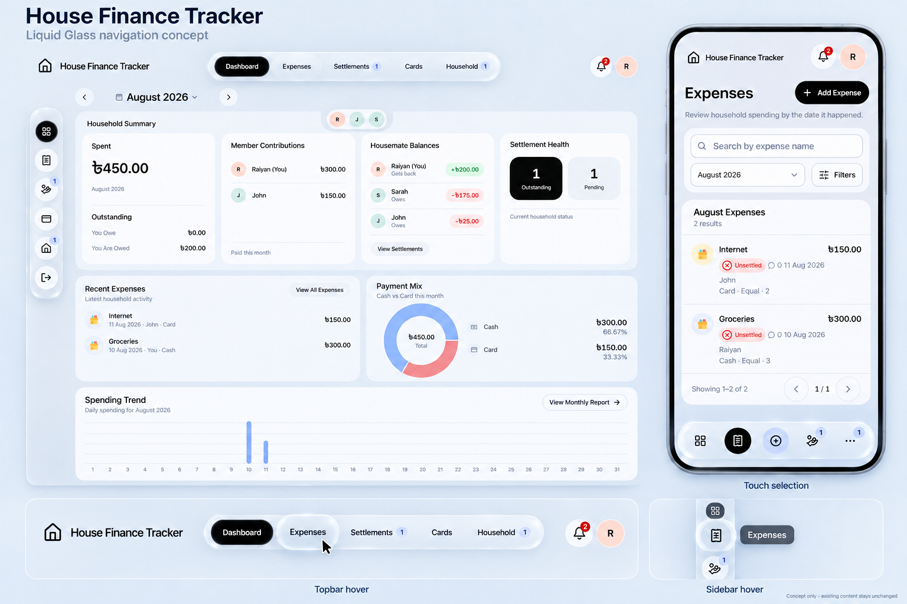

# Liquid Glass navigation concept — 2026-10-14

**Subsequent implementation:** the owner approved this revision with desktop-only hover and animated glass tab selection. G1–G3 implements it locally; see the [actual gallery](../glass-implementation-2026-10-14/index.html) and [verification record](../GLASS_IMPLEMENTATION_VERIFICATION_2026-10-14.md). The following G0 scope and preservation statements describe the earlier concept phase, rather than the current implementation status.

G0 is complete, including the owner's scope correction: glass on the desktop header is limited to the center capsule from **Dashboard through Household**, excluding the logo/wordmark and notification/profile areas. [The revised design board](liquid-glass-navigation-v2.png) shows this in both rest and hover states, preserving the sidebar and mobile dock treatment. It was edited with built-in imagegen; [the revision prompt](PROMPT_V2.md) and [source-preservation check](verification-v2.json) are retained. No application implementation or deployment occurred.

The [first concept](liquid-glass-navigation.png), [original prompt](PROMPT.md) and [actual application references](references/) remain historical evidence; its full-width glass header is superseded.

## Feasibility and intended behavior

A web approximation is feasible with translucent backgrounds, [CSS backdrop filtering](https://developer.mozilla.org/en-US/docs/Web/CSS/Reference/Properties/backdrop-filter), layered rim/inner highlights and restrained [scale transforms](https://developer.mozilla.org/en-US/docs/Web/CSS/Reference/Properties/transform). These browser capabilities support the proposed treatment; they do not establish an exact reproduction of Apple's native compositor or optics. No additional dependency or paid service is needed for the basic material and hover treatment.

- **Desktop topbar:** the only glass surface is the centered capsule spanning Dashboard, Expenses, Settlements, Cards and Household, including existing badges. The wordmark/logo, bell and profile remain outside on the ordinary background. Hover magnification applies only to controls inside this capsule; it never changes the active route. The proposed shallow lens highlight and roughly 1.06–1.10 scale retain readable labels, badges, spacing and stable hit regions.
- **Desktop sidebar:** the existing compact, centered icon column gets a slim frosted dock. Hovered icon can grow approximately 1.12–1.16, with a smaller nearby response, clear edge highlight and existing tooltip. Keep the current reserved column, route order, Sign Out authority and content alignment.
- **Mobile bottom dock:** use the same glass material on the accepted floating pill. Retain exactly Dashboard, Expenses, Add, Settlements, More, existing counts and active-route semantics. Touch gets subtle press/selection feedback; essential controls never depend on hover. The periwinkle Add control and black selected pills remain recognizable.
- Keep keyboard focus clearly visible. Enable pointer magnification only when [the input supports hover](https://developer.mozilla.org/en-US/docs/Web/CSS/Reference/At-rules/@media/hover), respect [reduced motion](https://developer.mozilla.org/en-US/docs/Web/CSS/Reference/At-rules/@media/prefers-reduced-motion), and retain a readable opaque fallback. Animate the control visual rather than the entire shell so fixed menus and hit regions are not disturbed.

Magnification and timing are proposed design values, not measured or approved implementation settings. This phase reviewed current components/styles and browser documentation; it did not build or benchmark the effect. A future implementation should verify text contrast over different scroll positions, control overlap/tooltip clipping, focus and popovers, reduced motion, narrow/short viewports and blur performance.

## Matching contract

The requested navigation treatment is a proposed exception to the earlier desktop-preservation rule, limited to the Dashboard-to-Household capsule, compact web sidebar and mobile dock. The rest of the topbar remains ordinary. The accepted page layouts, content panels, typography, gray/blue-gray canvas, current icons/avatars, black actions, chart colors, routes, money, actor permissions and domain/data behavior remain the authority. Financial content panels remain opaque and unchanged.

The image is illustrative: its outer desktop frame and phone hardware outline are presentation framing, not new application chrome. Preserve actual component geometry and selected black pills if a closeup differs. Do not copy generated glyph substitutions, exact glare, tiny chart geometry or incidental spacing into business/UI behavior. The static hover closeups depict separate moments and do not prove an animation, refraction or performance implementation. Credits remains removed.

## Preservation

The [source check](verification.json) confirms all 455 existing source files match the start of this phase. That baseline includes the accepted mobile implementation, rather than reverting to the earlier production UI. Only concept/reference/prompt/evidence and AIDOS status documents changed. No application stylesheet/component, dependency, configuration, provider, production user record or deployment changed. Implementation remains a later owner-authorized phase.
